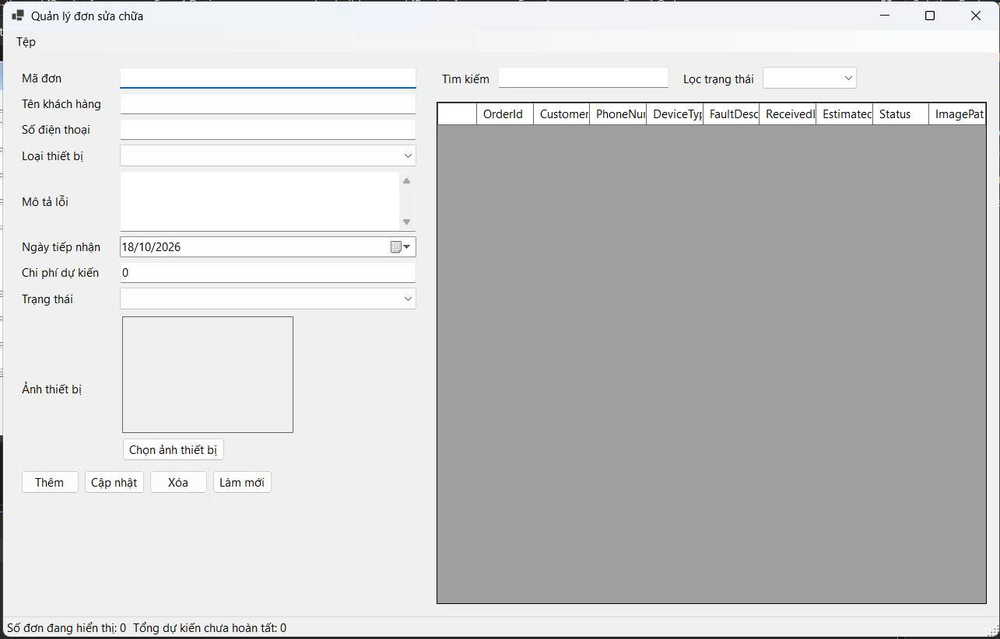
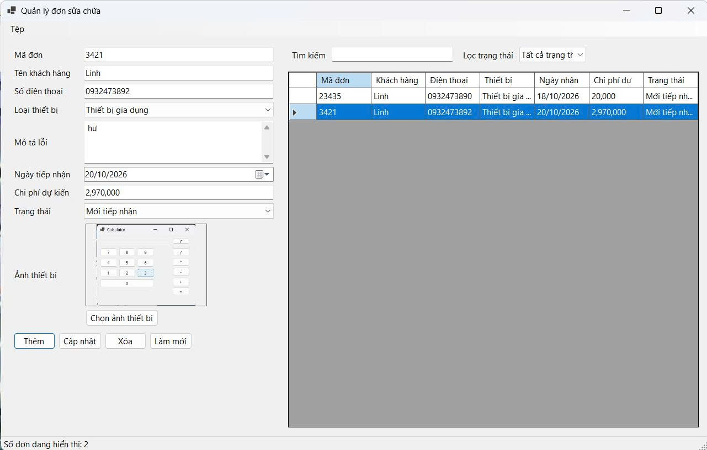
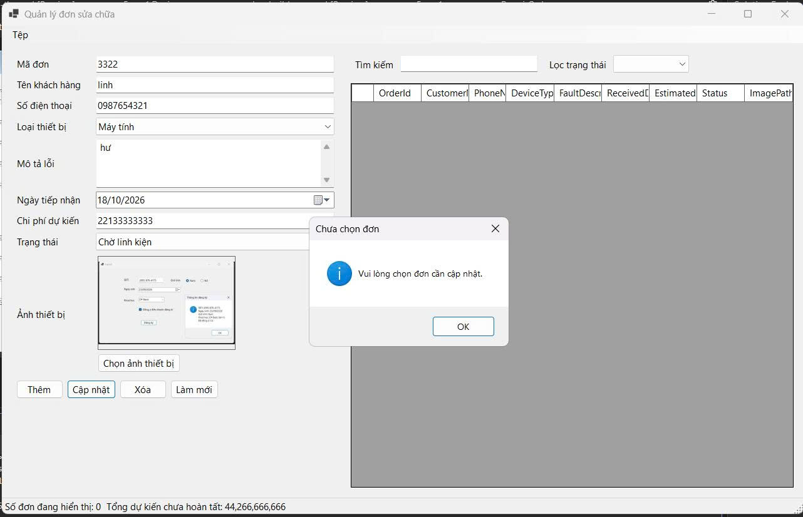
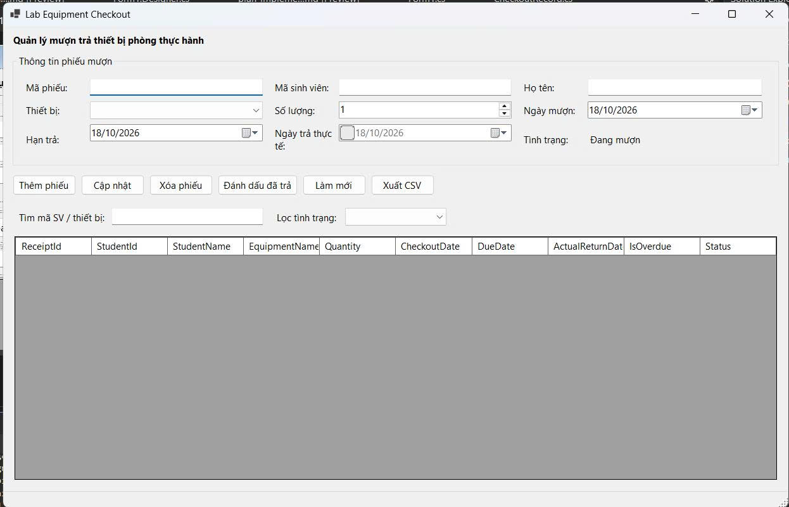
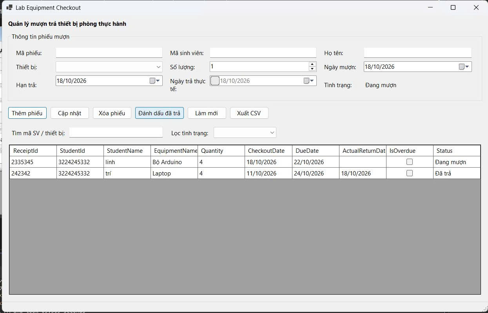
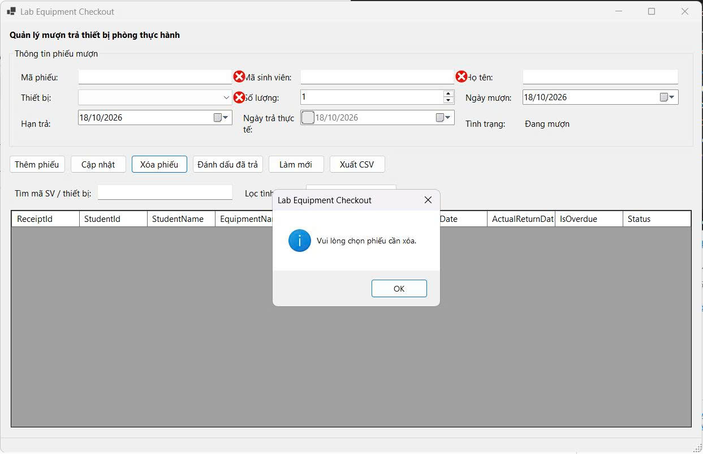
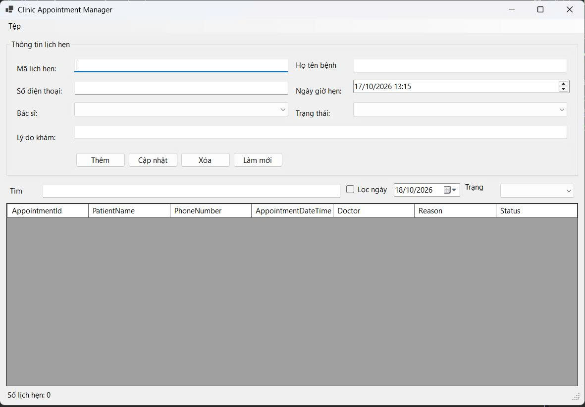
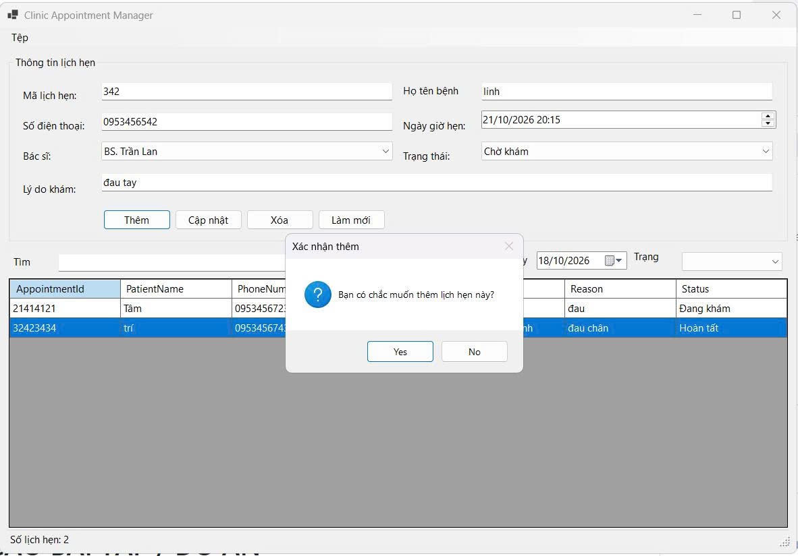
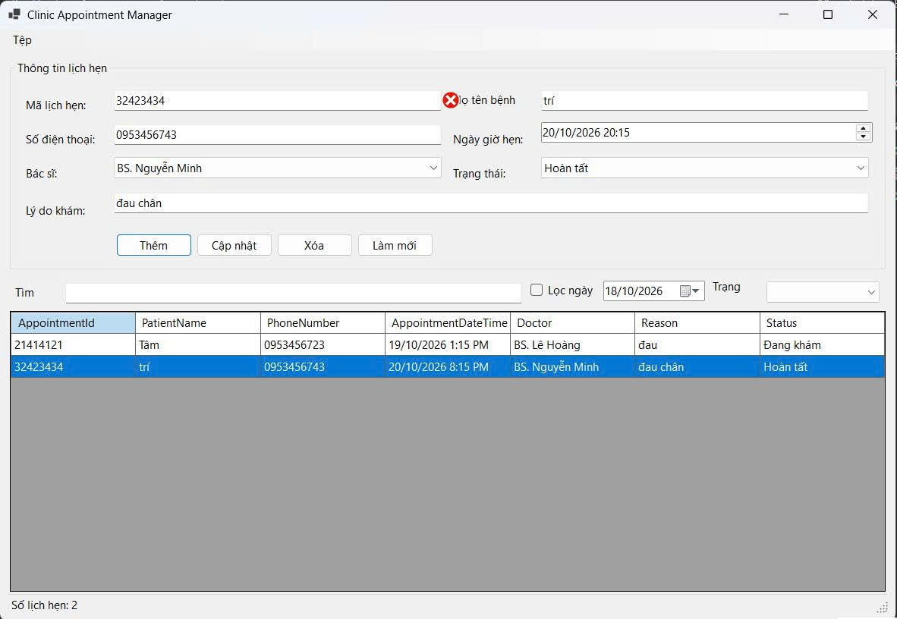

# BÁO CÁO BÀI TẬP / ĐỒ ÁN

## THÔNG TIN SINH VIÊN
- **Họ và tên:** Nguyễn Hoàng Linh
- **Mã số sinh viên:** 24810320338
- **Lớp:** D19QTANM1
- **Tên môn học:** Lập trình C# / Windows Forms
- **Tên bài tập:** Bt 4.9-4.10-4.11

---

## KẾT QUẢ THỰC HÀNH

### **B 4.9**
### 1. Ảnh màn hình Giao diện chính

### 2. Ảnh màn hình Chức năng thực thi / Kết quả

### 3. Ảnh màn hình Kiểm tra lỗi (Validation)

---
### **B 4.10**
### 1. Ảnh màn hình Giao diện chính

### 2. Ảnh màn hình Chức năng thực thi / Kết quả

.jpg)
### 3. Ảnh màn hình Kiểm tra lỗi (Validation)

---
### **B 4.11**
### 1. Ảnh màn hình Giao diện chính

### 2. Ảnh màn hình Chức năng thực thi / Kết quả

.jpg)
### 3. Ảnh màn hình Kiểm tra lỗi (Validation)

---
